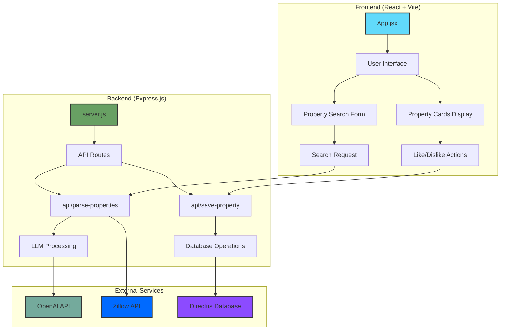

# Property Search Application Architecture

## Architecture Components

### Frontend
- **React + Vite**: Modern UI framework with fast development experience
- **Tailwind CSS**: Utility-first CSS framework for styling
- **Components**:
  - Search form for property requirements
  - Property cards display
  - Like/Dislike functionality

### Backend
- **Express.js**: Node.js web application framework
- **API Routes**:
  - `/api/parse-properties`: Processes user search input
  - `/api/save-property`: Saves user preferences

### External Services
- **OpenAI API**: Processes natural language input to extract property requirements
- **Zillow API**: Provides real estate property data
- **Directus**: Headless CMS used as database for storing user preferences

### Data Flow
1. User enters property requirements in natural language
2. Frontend sends request to backend
3. Backend uses LLM (OpenAI) to parse requirements
4. Backend queries Zillow API with structured requirements
5. Property results are returned to frontend
6. User can like/dislike properties
7. Preferences are saved to Directus database
8. (Future) Recommendation engine will use saved preferences

## Technology Stack
- **Frontend**: React, Vite, Tailwind CSS
- **Backend**: Express.js, Node.js
- **AI/ML**: OpenAI, LangChain
- **Database**: Directus
- **APIs**: Zillow API
